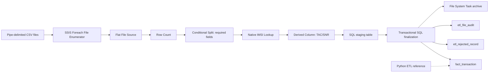

# DEPI R5 Telecom ETL Case Study

An executable SQL Server ETL implementation for the DEPI R5 telecom transaction case study. The repository contains a verified native SSIS implementation plus the Python/T-SQL implementation as a reference alternative. Original assignment datasets are intentionally excluded from this public repository because they contain telecom identifiers.

## Requirements

- Windows and SQL Server (tested target: local SQL Server Express instance `SQLEXPRESS`)
- Python 3.11+ and `pyodbc`
- ODBC Driver 17 or 18 for SQL Server
- SSMS or `sqlcmd` for database setup

Verified native tooling: Visual Studio Community 2022 17.14.40, SSIS Projects extension 1.4, TargetServerVersion `SQLServer2019`, and SQL Server 2019 DTExec 15.0.2000.5. The native package is `ssis/VsGenerated/TelecomETL/TelecomETL/Package.dtsx` and is built into an `.ispac` by the supplied solution.

## Workflow

## Transformation rules

- Missing IMSI, CELL, LAC, or invalid/missing EVENT_TS rejects the complete source row.
- Unknown but non-null IMSI is valid and receives `subscriber_id = -99999`.
- IMEI remains text. For length >= 14, TAC is the first 8 characters and SNR the last 6; otherwise both are `-99999`.
- Original rejected values, filename, SHA-256, source row number, and rejection reason are retained.
- The Python implementation skips successful source-file hashes on rerun. The native package uses a clear-and-finalize staging cycle plus source-file keyed finalization so reruns replace the same file’s results without duplicating rows.

## Setup and execution

1. Copy `config.example.json` to `config.json` and set folders/connection string. Do not commit `config.json`.
2. Run `sql/01_schema.sql` in SSMS, then load reference data with `sql/02_reference.sql` in SQLCMD mode.
3. Install dependencies in a virtual environment: `python -m pip install -r requirements.txt`.
4. Use the clearly synthetic files in `sample_data/` for a smoke test, or supply your own pipe-delimited files with the documented seven source columns. The original assignment files are not included here.
5. Run `python -m etl.run --config config.json`.

The native package stages each file through a real Flat File Source, routes required-field failures through a native Conditional Split, executes a native IMSI Lookup against the reference table, applies native TAC/SNR Derived Column expressions, and uses SQL procedures only for transactional finalization, rejection persistence, audit logging, and recovery. It moves the current file to a per-file archive target only after finalization succeeds. The Python implementation retains the same business rules and remains runnable independently.

To build and run the native package, open `ssis/VsGenerated/TelecomETL/TelecomETL.sln` in Visual Studio Community 2022, confirm `TargetServerVersion=SQLServer2019`, build the `Development` configuration, and execute the resulting package with SQL Server 2019 DTExec. The generator is `tools/BuildNativePackage.cs`.

## Testing

Run `python -m unittest discover -s tests -v`. The tests cover required-field rejection, timestamp validation, known/unknown IMSI behavior, IMEI derivation, null/short IMEI, and parsing all supplied files. The Python baseline processed 1,832 rows: 1,741 loaded, 91 rejected, and 13 archived. The independent native SSIS run produced the same counts, 1,004 lookup matches, 737 lookup misses, zero TAC/SNR mismatches, and 13 archived files. DTExec logs show the native Lookup loaded and processed the 1,000-row reference cache for every file. A native rerun remained at 1,741 valid, 91 rejected, and 13 audit rows; an induced archive failure left all 13 files recoverable before a successful retry.

## Verification reference

The implementation was verified locally against the private assignment dataset: 1,832 input rows, 1,741 valid rows, 91 rejected rows, 1,004 lookup matches, 737 misses, zero TAC/SNR mismatches, and 13 archived files. Those source files are intentionally absent from this public repository.

## Repository layout

- `sample_data/`: small synthetic pipe-delimited smoke-test files.
- `sql/`: idempotent schema and reference-loader entry point.
- `etl/`: executable parser and SQL Server loader.
- `ssis/VsGenerated/TelecomETL/`: native SSIS solution, project, and `.dtsx` package.
- `tools/`: native package generator and runner.
- `tests/`: automated transformation and real-file parsing tests.
- `config.example.json`: safe configuration template.

## Limitations and future improvements

This is a local, single-process development implementation and has no scheduler, cloud deployment, or production SSIS Catalog deployment. Future improvements could add SSIS Catalog environments, operational alerting, quarantine folders, and scheduling.

## Author

Youssef Mahmoud Farouk — Computer Engineering Graduate | Junior Data Engineer | Python & SQL
